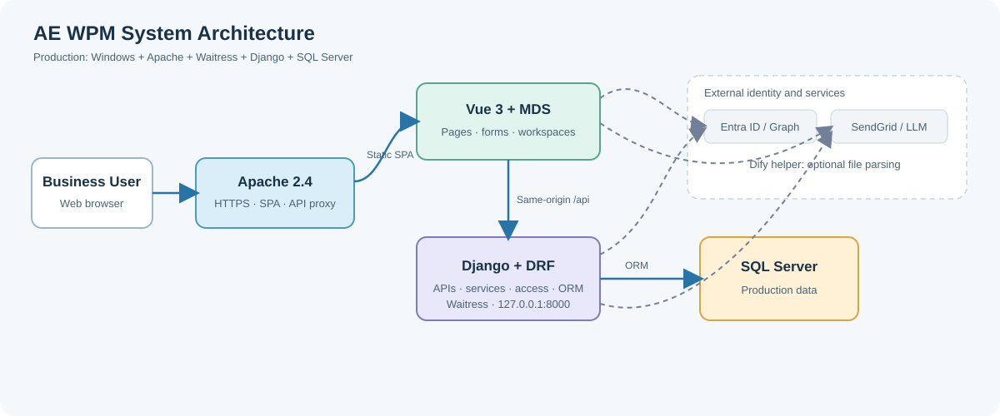
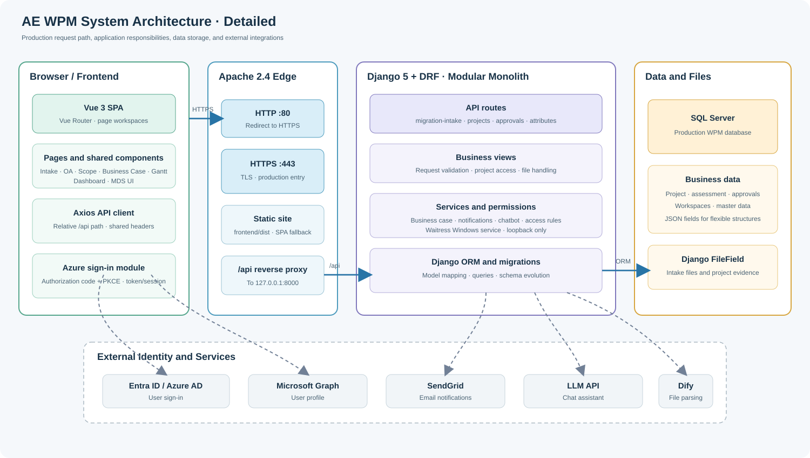
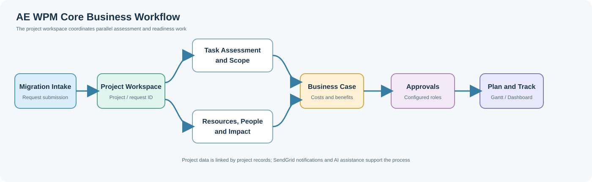
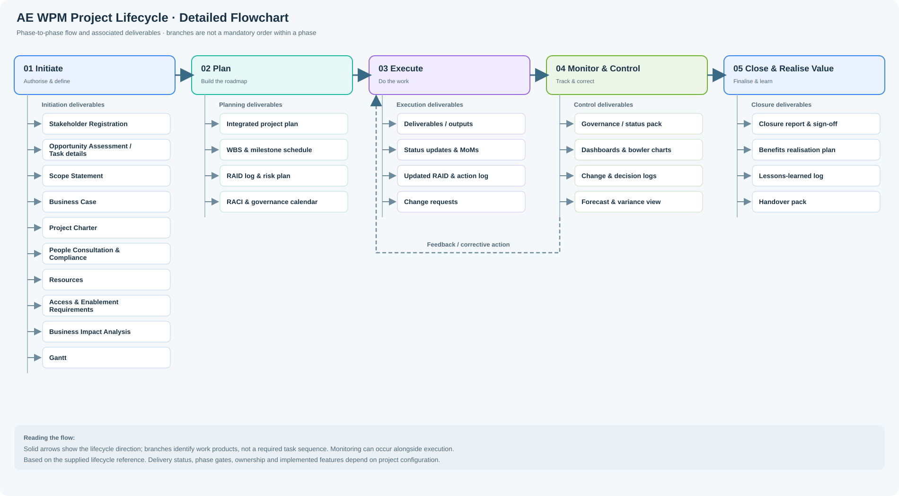

# AE WPM Technical Architecture

> Prepared from the current source code and deployment documentation. Recommendations are proposed directions, not features already implemented.

## 1. Executive Overview

AE WPM is an internal portal for managing the migration project lifecycle, from intake and assessment through business case, approvals, and execution tracking.

The current solution is a **frontend-backend separated modular monolith**: Vue 3 provides the web application, Django REST Framework exposes the APIs, and SQL Server stores production data. In production, Apache on Windows provides HTTPS, serves the SPA, and reverse-proxies API requests.

## 2. System Architecture

### Overall

### Detailed

| Layer | Current technology and responsibility |
|---|---|
| Frontend | Vue 3, Vue Router, and Maersk Design System (MDS); business pages, forms, and project workspaces. |
| Edge | Apache handles HTTPS, SPA assets, and `/api` reverse proxying. |
| Backend | Django 5 and DRF; business routes, views, services, and models run as one backend application. |
| Data and integrations | Django ORM; SQL Server in production and SQLite in development; Entra ID, SendGrid, and LLM API integrations. |

Development uses Vite on port `3002`, Django on `8001`, and SQLite. The production backend listens on loopback port `8000` and should not be exposed directly to the network. See [DEPLOYMENT.md](./DEPLOYMENT.md).

## 3. Core Business Workflow

### Overall

### Detailed

The detailed flowchart follows the five lifecycle phases and deliverables in the supplied process reference. Branches show associated work products, not a mandatory order within a phase; actual availability and status depend on project configuration and implemented system features.

Workspaces are associated through the project record or `migration_request_id`. The main business domains are:

- **Project and assessment:** Intake, Opportunity Assessment, and Scope Statement.
- **Project readiness:** Project Charter, resources, access enablement, stakeholder registration, and people consultation.
- **Financial case and approvals:** Business Case, cost rates, approval roles, and approval status.
- **Tracking and portfolio views:** Gantt, Migration Dashboard, BPM ROFO, and BPM Actual.
- **Master data:** Product ownership, GSC site mapping, service catalogue, working hours, and access configuration.

Django ORM manages project, assessment, and approval data. Some flexible workspaces use JSON fields; selected records also track revisions or audit information. Attachments are handled through Django `FileField`.

## 4. Key Technical Flows

- **Identity and access:** The frontend signs in with Entra ID and sends identity-related request headers. The backend applies project requestor/team, Super Admin, or master-data access rules.
- **Email:** The backend sends notifications through SendGrid.
- **AI assistant:** Django extracts query filters, retrieves business data, then calls an LLM to generate an answer. The repository also contains a Dify file-parsing helper, separate from the chatbot's primary flow.
- **Deployment:** Apache is the user entry point and proxies APIs to Django on Waitress. Production data is stored in SQL Server; local development uses Vite, Django, and SQLite.

## 5. Recommended Evolution Priorities

1. **Strengthen the identity trust boundary.** The current backend identity helper reads JWT claims and accepts an `X-User-Email` fallback, but the helper itself does not validate JWT signature, issuer, or audience. Confirm whether a trusted upstream component performs validation; otherwise, add standard backend validation and restrict mock identity to controlled development environments.
2. **Improve data resilience.** Define production attachment storage, backup, and recovery; standardize audit and concurrent-edit controls across workspaces; strengthen SQL Server migration testing.
3. **Improve release and operations.** Gradually automate tests, migration approvals, backup checks, health checks, and rollback validation. Add monitoring for APIs, the database, and external email/LLM dependencies.
4. **Avoid splitting services prematurely.** The modular monolith fits the current business shape. Strengthen module boundaries first; consider microservices only when scale, team ownership, or independent scaling needs justify them.

## Executive Conclusion

**The current direction is “frontend-backend separation + modular monolith + centralized Windows deployment.”** Prioritize identity security, data resilience, and operational maturity before adding infrastructure or service-splitting complexity.

**Code references:** [README.md](./README.md), [backend/config/settings.py](./backend/config/settings.py), [backend/api/models.py](./backend/api/models.py), [frontend/src/router/index.js](./frontend/src/router/index.js), and [backend/api/permissions/attributes_access.py](./backend/api/permissions/attributes_access.py).
